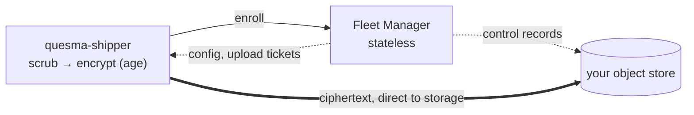

# Quesma Shipper

[](#developer-install-the-shipper-each-machine)

Quesma Shipper collects the session files that AI coding agents write on developer machines,
redacts the secrets and personal data its rules detect in transcripts and context files, encrypts
everything, and uploads the ciphertext to object storage your organisation controls. It is two
parts: **the shipper** ([`src/`](src/README.md)), a background service on each developer machine,
and **[Fleet Manager](fleet-manager/)**, the control plane you run in your own cloud, which enrolls
shippers and signs each upload but never sees file contents.



Each upload is sealed to the organisation's [age](https://age-encryption.org/) recipients, and any
one of their private keys can decrypt it: your custodians' and, if you turn Quesma ETL on,
Quesma's. Account and usage records are encrypted but not scrubbed.

Supported agents: Claude Code, Codex, Cursor, GitHub Copilot (the Copilot CLI and Copilot Chat in
VS Code), Pi\*, OpenCode\*, Hermes\*. Supported platforms: macOS 13 or newer, Linux, Windows 10
1809 or newer. The project is pre-1.0: the wire protocol, the configuration format and the object
naming are pinned by tests but can still change between minor releases.

\* Experimental. We actively run and test Claude Code, Codex, and Cursor.
Pi, OpenCode, and Hermes support may change or be withdrawn.

OpenCode collection requires a SQLite-backed store: V1 layouts with `session`,
`message`, and `part`, or V2 layouts with `session_v2` and `session_message`
(including the transitional shared-session layout). Pre-SQLite V1 releases before
[v1.2.0](https://github.com/anomalyco/opencode/releases/tag/v1.2.0) whose history
exists only as `storage/session/*/*.json`, `storage/message/*/*.json`, and
`storage/part/*/*.json` are unsupported. This storage-format boundary, rather than
a semver cutoff, also applies to development/channel builds. JSON copies left
behind after SQLite migration are deliberately ignored; no stale history is
re-uploaded from them.

`opencode-tool-outputs` collects full text spills only when enabled, supported
OpenCode transcripts reference their `outputPath` in truncated tool metadata.
Only flat `tool-output/tool_*` files inside the same configured data root are
eligible (64 MiB per file by default), with normal deny rules, repository ignores,
symlink rejection and scrubbing. Keys use the root-relative spill path, as for
Claude Code tool results; a spill referenced by several sessions/databases ships
once. Unreferenced/expired spills, credentials, arbitrary referenced paths and
unrelated storage are not collected. Disabling `opencode-sessions` also disables
spill discovery; no whole-data-directory scan or legacy JSON fallback is performed.

## Get started

| | |
| --- | --- |
| **Try&nbsp;it&nbsp;first** | [**WALKTHROUGH.md**](fleet-manager/WALKTHROUGH.md): every step below on a throwaway deployment, a container as the developer machine, torn down at the end. About fifteen minutes. |
| **Set&nbsp;it&nbsp;up** | [Operator: set up Fleet Manager](#operator-set-up-fleet-manager-once), once, in your AWS account or Google Cloud project. |
| **Join&nbsp;it** | [Developer: install the shipper](#developer-install-the-shipper-each-machine), on each machine. |

## Operator: set up Fleet Manager (once)

To run a self-managed Quesma Shipper fleet that sends data to a bucket you own, first deploy
Fleet Manager in your cloud account. Fleet Manager is the shared service that enrolls developer
machines, supplies their collection settings and encryption recipients, and authorizes uploads.

The steps below walk you through a reference setup on **AWS ECS Express Mode with an S3 bucket**
or **Google Cloud Run with a Cloud Storage (GCS) bucket**. The deployment script creates Fleet
Manager, the bucket, and the cloud permissions they need. You then use its admin UI to create
your organisation and invite developers to join. Set this up once for your fleet; developers
can then follow [the shipper installation steps](#developer-install-the-shipper-each-machine)
on each machine.

1. **Have ready:** an AWS account or Google Cloud project you can create resources in, and on your
   laptop Terraform or OpenTofu, `curl`, `age`, `age-keygen`, `rclone`, Go, and the `aws` CLI signed
   in, or `gcloud` with `gcloud auth application-default login`. On AWS the Region needs a default
   VPC.

2. **Decide two things** before anything enrolls. Ask two custodians to each run `age-keygen -o
   name.agekey` and send you only their `age1…` public recipient (`age-keygen -y name.agekey`
   prints it); their private identities are your only way to read what is uploaded, so they
   must be kept and backed up. Decide whether Quesma may decrypt uploads, for its dashboards; it is
   off unless you say `--quesma-etl` below. Files uploaded before it was on can be opened for Quesma
   later only by a custodian resealing them.

3. **Deploy:**

   ```sh
   curl -fsSLO https://raw.githubusercontent.com/QuesmaOrg/quesma-shipper/main/fleet-manager/deploy.sh

   BUCKET_NAME=acme-trajectories   # has to be globally unique: no other AWS or Google Cloud customer has it
   GCLOUD_PROJECT_ID=acme-prod     # Google Cloud only: an existing project ID with a billing account linked

   sh deploy.sh aws --bucket $BUCKET_NAME --region eu-central-1                                # AWS, or
   sh deploy.sh gcp --bucket $BUCKET_NAME --project $GCLOUD_PROJECT_ID --region europe-central2  # Google Cloud
   ```

   It shows the plan, asks for `yes`, and after a few minutes prints the service URL, the admin UI
   address and the admin credential. Keep `~/.quesma/fleet-manager/<cloud>/` backed up, since the
   Terraform state is there. Running the same command again applies the latest template; upgrading
   the service image is in [OPERATIONS.md](fleet-manager/OPERATIONS.md). `sh deploy.sh aws output
   admin_credential` prints the credential again; `sh deploy.sh --help` lists the rest.

4. **Open the admin UI**, paste the credential, and create the organisation: a slug such as `acme`
   (permanent, it is part of every object key), a display name, the two recipients, the Quesma
   checkbox. Verify a custodian can decrypt a test file sealed to those recipients:

   ```sh
   echo test | age -r age1… -r age1… -o test.age     # the two recipients you registered
   age -d -i name.agekey test.age                    # a custodian, with their private identity
   ```

5. **On the Invites page**, create one invite per developer; its `fmi2.…` token is shown once.
   Send the token and the service URL to each developer through a secret-sharing channel. Each OS
   user on a machine enrolls separately, as its own install. A grant, on the Grants page, enrolls
   any number of installs until it expires or is revoked, which suits shared machines and MDM
   rollouts.

6. **Later, read what arrived** with a custodian key. `active` on the Installs page means a machine
   enrolled, not that it has shipped anything. Download `quesma-unseal`, copy the organisation's
   objects with [rclone](https://rclone.org/) (here an `s3` remote named `aws`: `rclone config
   create aws s3 provider AWS env_auth true`), then decrypt them. Keep the key and both copies in a
   directory of their own (`W` below), outside any clone of this public repository: the decrypted
   files are your developers' transcripts.

   ```sh
   B=$(sh fleet-manager/deploy.sh aws output bucket)
   W=~/quesma-acme   # holds name.agekey, quesma-unseal, enc/ and plain/
   curl -fsSL -o "$W/quesma-unseal" https://updates.quesma.dev/download/quesma-unseal-darwin-arm64
   curl -fsSL https://github.com/QuesmaOrg/quesma-shipper/releases/latest/download/quesma-unseal-SHA256SUMS |
     awk '$2 == "quesma-unseal-darwin-arm64" { print $1 "  quesma-unseal" }' |
     (cd "$W" && shasum -a 256 -c) && chmod +x "$W/quesma-unseal"
   rclone copy "aws:$B/v1/organization=acme" "$W/enc" --include 'install=*/**'
   "$W/quesma-unseal" open -i "$W/name.agekey" "$W/enc" "$W/plain"
   ```

   For another platform, swap `darwin-arm64` for `darwin-amd64`, `linux-amd64`, `linux-arm64`,
   `windows-amd64.exe` or `windows-arm64.exe`, in both places. The binary becomes executable only
   once its hash matches the one on the GitHub release, a source apart from the download server; while
   a release is being published the two may differ, so download both again. On Linux without
   `shasum`, `sha256sum -c` takes the same input. On Windows, compare `(Get-FileHash <file>).Hash`
   with the file's line in `quesma-unseal-SHA256SUMS`. The macOS and Windows
   builds are signed, and the macOS ones notarized: on macOS,
   `codesign --verify --strict -R='anchor apple generic and certificate leaf[subject.OU] = "66ZNG89HN6"' "$W/quesma-unseal"`
   also checks it is Quesma's. Each shipper release carries its own `quesma-unseal`
   (`quesma-unseal version` names it), and an older one may refuse objects from newer shippers, so
   download it again after the shipper updates. From an up-to-date clone,
   `(cd src && go run ./cmd/quesma-unseal open …)` does the same without the download.

   On Google Cloud, `deploy.sh gcp output bucket` and a `gcs` remote; on Azure, the container name
   and an `azureblob` remote. `$W/plain` holds `<install name> (<id prefix>)/<source>/<native path>`,
   or the install id when unnamed, each file beside a `.manifest.json` sidecar. Re-running both
   commands fetches and decrypts only changed objects. An object whose output moved, because its
   install was renamed or its session archived, leaves no copy at the old path; nothing else is
   deleted, so an erased install's files stay. An object that fails is named on stderr, retried on
   the next run, and makes the exit status 1.

What the script creates, and running the template by hand with your own image or your own
state: [fleet-manager/terraform/aws](fleet-manager/terraform/aws/README.md),
[fleet-manager/terraform/gcp](fleet-manager/terraform/gcp/README.md). Rotating the credential,
revoking installs, upgrading, backups and letting an outside ETL read the bucket:
[fleet-manager/OPERATIONS.md](fleet-manager/OPERATIONS.md). Everything on one laptop instead, with
no cloud account: [On one machine](fleet-manager/README.md#on-one-machine).

## Developer: install the shipper (each machine)

1. **Install.** Personal installations need no administrator rights. The macOS package and
   Windows setup also offer an administrator-managed all-users installation.
   - macOS: `brew install --cask quesmaorg/tap/quesma-shipper`, or the signed
     [quesma-shipper-macos-universal.pkg](https://updates.quesma.dev/download/quesma-shipper-macos-universal.pkg)
   - Linux: `curl -fsSLO https://raw.githubusercontent.com/QuesmaOrg/quesma-shipper/main/src/packaging/linux/install.sh && sh install.sh`
   - Windows: run [QuesmaShipperSetup-amd64.exe](https://updates.quesma.dev/download/QuesmaShipperSetup-amd64.exe)
     (x64) or [QuesmaShipperSetup-arm64.exe](https://updates.quesma.dev/download/QuesmaShipperSetup-arm64.exe) (Arm)

2. **Enroll** with the token and URL the operator sent:

   ```sh
   quesma-shipper login <token> --server https://fleet-manager-url
   ```

3. **Run `quesma-shipper doctor`.** It should say it is sending to your organisation. The service
   ships on start and then every 15 minutes, and keeps itself up to date.

Uninstalling, MDM and Intune deployment, what is collected, and how to pause or configure it:
[src/README.md](src/README.md).

## Learn more

[fleet-manager/WALKTHROUGH.md](fleet-manager/WALKTHROUGH.md) rehearses everything above on a
throwaway deployment; [fleet-manager/README.md](fleet-manager/README.md) covers the control plane;
[CONSTITUTION.md](CONSTITUTION.md) the design rules; [ARCHITECTURE.md](ARCHITECTURE.md) the code
layout; [CONTRIBUTING.md](CONTRIBUTING.md) building, testing and releases; [SECURITY.md](SECURITY.md)
reporting a vulnerability. The wire contract is the [shipper-protocol/](shipper-protocol/) module.
Do not attach real
trajectories, agent databases, logs or credentials to issues or pull requests.

## License

Apache License 2.0. See [LICENSE](LICENSE) and [NOTICE](NOTICE). `quesma-shipper licenses` prints the
license and every bundled dependency's license text; Fleet Manager keeps its own in
[fleet-manager/NOTICE](fleet-manager/NOTICE) and `fleet-manager/third_party/`. Quesma, Quesma
Shipper, Quesma Fleet Manager, and the Quesma logo are trademarks of Quesma Inc.; the license does
not grant trademark rights. If you distribute a modified build, read [TRADEMARKS.md](TRADEMARKS.md)
before you name it.
